

# Tune

An ad-free YouTube Music player for **Windows** and **Android**. No ads, light on battery, and your own colours.
Sign-in is optional: use Google only if you want your library on every device.

  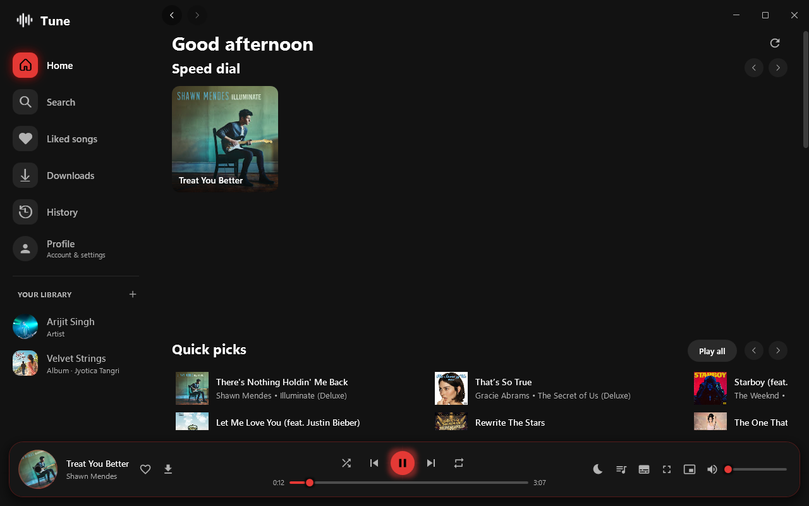
  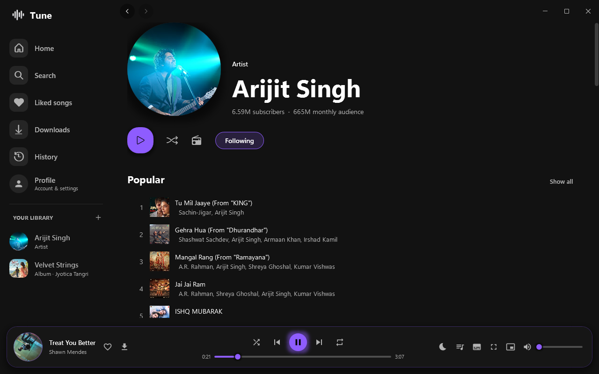

## What it does

**Listen**
- A Home made from what you play: **Speed dial**, **Quick picks**, *Because you played*, *Forgotten favourites*, top artists and YouTube Music's own rows
- Search, with YouTube Music's **Moods & moments** and **Genres** when the box is empty
- Radio from any song, shuffle and repeat, sleep timer, synced lyrics
- Pick any accent colour: buttons, sliders, the player and highlights all follow it

**Artists & albums**
- **Follow artists** and **save albums**: they sit in Your Library next to your playlists
- Artist pages with subscribers and monthly audience, Popular songs, About, and **Show all** for every song, album and single
- Album pages with the artists, year, song count and length

**Your library**
- Liked songs, your own playlists, and **import any public YouTube Music playlist** from a link
- History by day; *Not interested* keeps a song out of your recommendations
- **Downloads and offline mode**: when the internet drops, Home switches to your downloads; Smart downloads keep fresh picks ready
- Optional **Continue with Google**: likes, playlists, history, followed artists, saved albums, pins and your Home layout follow you to every device

**Windows**
- **Full screen** Now Playing (F11): the cover's colours fill the screen, big synced lyrics, controls slide away when the mouse rests
- A floating **mini-player** that stays on top: wide (with what's up next), compact bar, card or album-art tile. Tune's window shrinks into it and grows back
- Media keys, tray, smooth scrolling, keyboard shortcuts (Space, Ctrl+K, F, F11, Esc)

**Android**
- A YouTube-Music-style **queue drawer**: tap Queue or drag it up and the player slides out of the way
- **Full screen** with big lyrics; swipe the cover for next/previous, tap it to play/pause
- **Home-screen widgets**: player bar, square, tall and a 1×1 album cover you can tap and swipe
- Background playback, lock-screen and headset controls

## Screenshots

**Windows** in a few accent colours

| | |
|---|---|
| 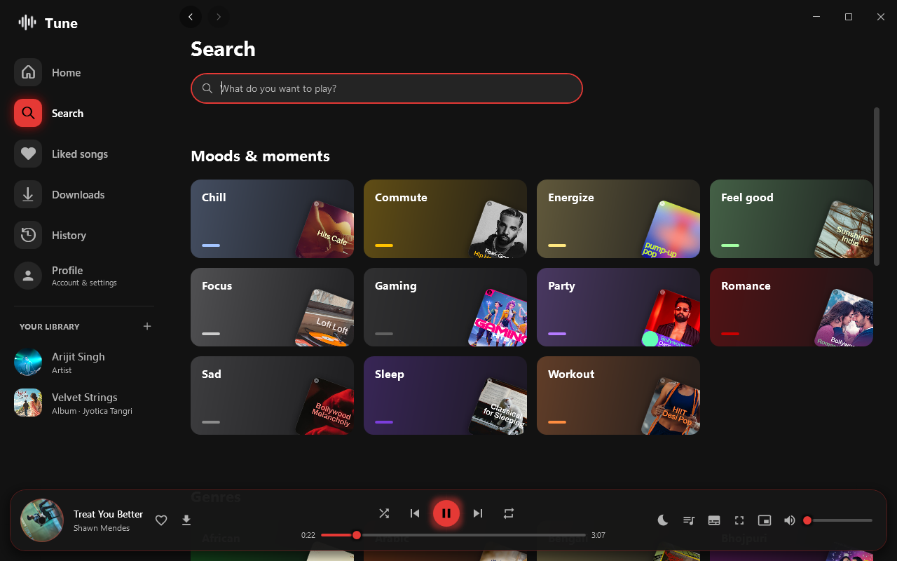 | 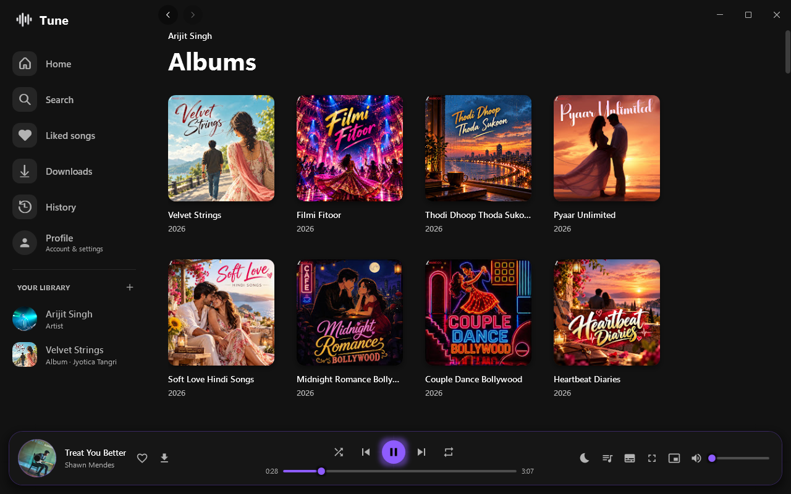 |
| Search: moods & genres (red) | Show all: an artist's albums (purple) |
| 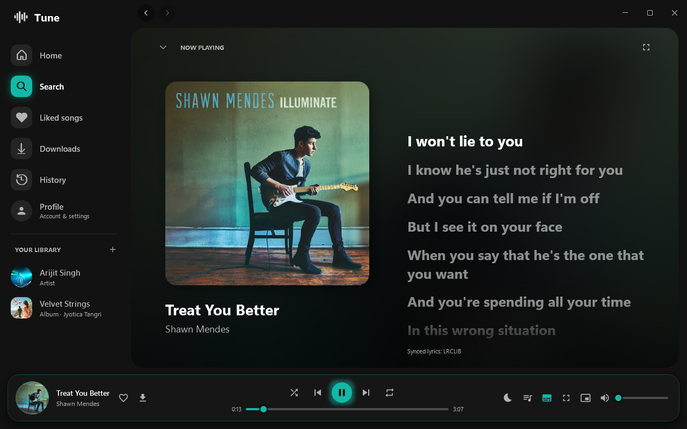 | 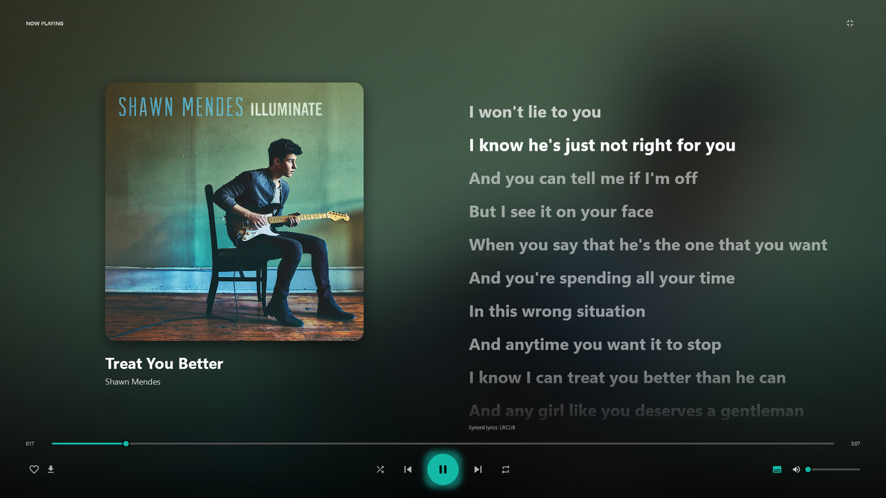 |
| Now Playing with synced lyrics (teal) | Full screen (teal) |

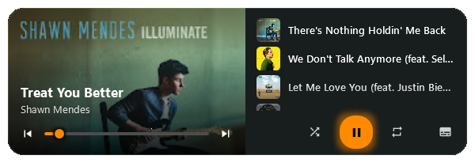 The wide mini-player (orange)

**Android**

  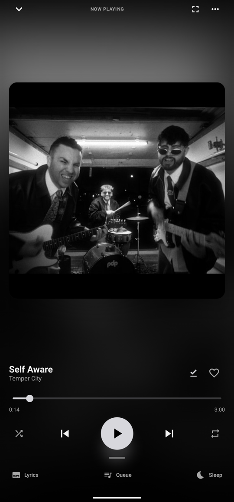
  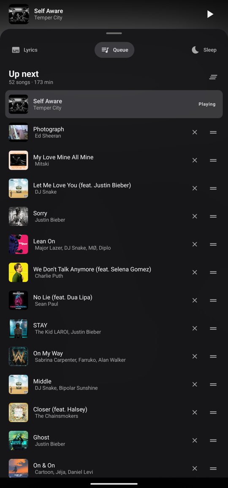
  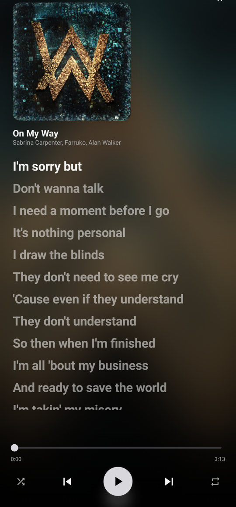
  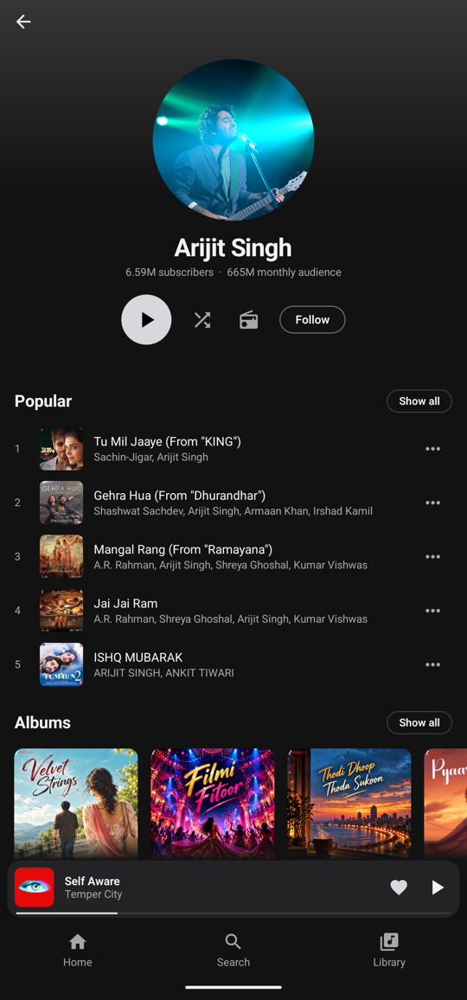
  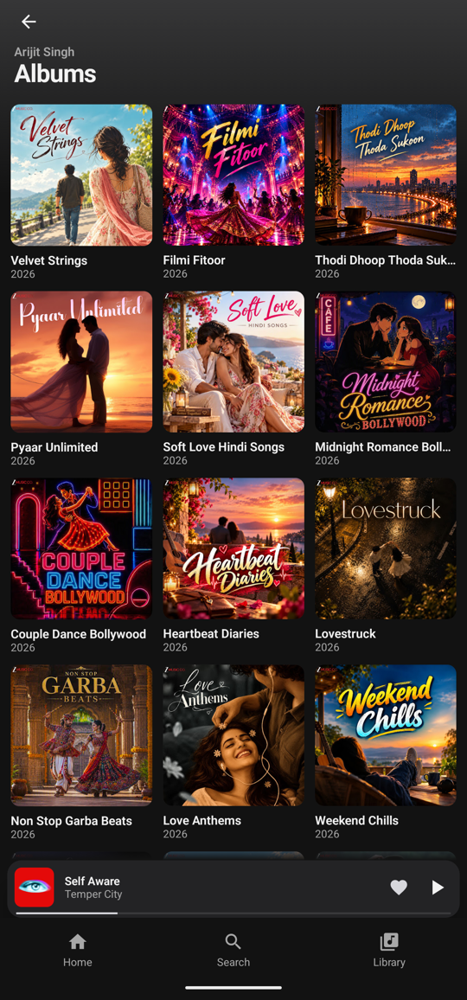

## Download

Get the latest files from the **[Releases](../../releases/latest)** page. Tune updates itself after that.

**Windows** (10/11, 64-bit): download `Tune.exe` and run it. Nothing else to install.
The first start downloads two small helpers (yt-dlp and deno) into `%LOCALAPPDATA%\Tune`.
Windows SmartScreen may warn because the app isn't signed: choose *More info → Run anyway*.

**Android** (9 or newer): download `Tune.apk` on your phone and open it. Allow *Install unknown apps* for your
browser or file manager when asked.

Without signing in, everything stays on your device. Tune uses YouTube Music's public pages anonymously; signing in
only syncs your own library through your account. Downloads always stay on each device.

## Build

- Windows: .NET 10 SDK, `tools\fetch-libmpv.ps1`, then `tools\publish.ps1` (local install) or `tools\release.ps1` (single exe).
- Android (`android/`): JDK 21 and the Android SDK, then `./gradlew assembleRelease`.
